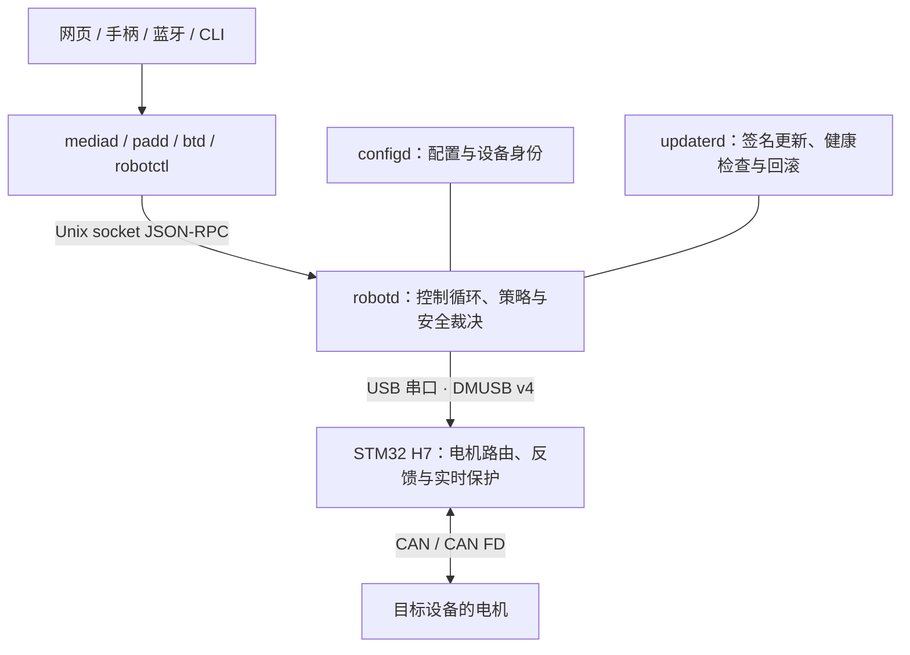

# xduck

**基于 RK3566 与 STM32 H7 的机器人控制软件，按设备保存上位机程序与下位机固件。**

本仓库集中管理 Xduck 与 Rider 系列设备的控制代码。RK3566 运行 Linux 服务，负责策略推理、控制调度、网页与通信；STM32 H7 负责电机总线、底层反馈和实时保护。两端通过 USB 串口上的 DMUSB v4 协议协作。

当前收录 **xduck1（121）、xduck2（122）、Rider（124）、Rider Mini（125）** 四台设备的源码，每台设备分别保存 `rk3566/` 和 `stm32/`，方便查找对应版本、比较设备差异和追溯构建来源。

[设备与版本](#设备与版本) · [目录结构](#目录结构) · [系统组成](#系统组成) · [开始阅读](#开始阅读) · [源码来源与校验](#源码来源与校验)

## 设备与版本

设备编号沿用局域网 IP 地址的末段。以下信息对应 **2026-11-16 整理的源码快照**，各目录的来源记录保存了当时的设备身份和安装版本。

| 设备 | 平台与配置 | 主要区别 | 源码入口 |
| --- | --- | --- | --- |
| **121** | **xduck1**，14 电机 GF/I2RT 配置 | 基础设备版本，包含控制、策略、网页与媒体相关模块 | [RK3566](121/rk3566/xduck/) · [STM32](121/stm32/stm32-h7-dm/) |
| **122** | **xduck2**，14 电机 GF/I2RT 配置 | 独立蓝牙屏、IMU 安装方向适配，以及 CPU 隔离、CPU/DDR 性能与策略超时诊断相关改动 | [设备说明](122/README.md) · [RK3566](122/rk3566/xduck/) · [STM32](122/stm32/stm32-h7-dm/) |
| **124** | Rider，10 电机 DM-J10422P-2EC 配置 | CAN1 ID 1–5、CAN2 ID 6–10；5+5 关节布局、Rider 网页、单个 SuperMimic 策略槽 | [设备说明](124/README.md) · [RK3566](124/rk3566/xduck/) · [STM32](124/stm32/stm32-h7-dm/) |
| **125** | Rider Mini，12 电机配置 | CAN1 奇数 ID／右侧、CAN2 偶数 ID／左侧；独立 Yesense USB IMU，网页以 HTTP-only 模式运行 | [设备说明](125/README.md) · [适配记录](125/RIDER_MINI_PORT.md) · [RK3566](125/rk3566/xduck/) · [STM32](125/stm32/stm32-h7-dm/) |

四台设备共享部分软件架构，但电机数量、路由、IMU、策略接口和构建参数存在差异。开发和构建时，请从目标设备自己的目录进入。

## 目录结构

```text
Xduck/
├── README.md
├── 121/                         # xduck1 基础设备
│   ├── rk3566/
│   │   ├── xduck/               # 完整 Rust workspace、网页、脚本和设计文档
│   │   ├── SOURCE-SHA256SUMS    # 归档源码校验清单
│   │   └── ...
│   └── stm32/
│       ├── stm32-h7-dm/         # STM32 H7 C/C++ 固件工程
│       ├── SOURCE-SHA256SUMS
│       └── PROVENANCE.json      # 来源与核对记录
├── 122/                         # xduck2 设备专用版本
│   ├── rk3566/
│   └── stm32/
├── 124/                         # Rider 5+5 / DM 电机版本
│   ├── rk3566/
│   └── stm32/
└── 125/                         # Rider Mini 十二电机版本
    ├── rk3566/
    └── stm32/
```

每台设备都保留完整工程，RK3566 的 Cargo workspace 不拆分。`PROVENANCE.json`、`BUILD-INFO.txt`、补丁和发布源码清单按各设备实际可用的记录保存，具体位置见设备说明。

### 分支用途

| 分支 | 内容 |
| --- | --- |
| [`main`](https://github.com/x-rangecraft/Xduck/tree/main) | 按设备编号组织的源码与说明，是当前浏览入口 |
| [`driver`](https://github.com/x-rangecraft/Xduck/tree/driver) | 目录调整前的原 `main`，完整保留当时的工程结构、文档、工具和 Git 历史 |

## 系统组成



### RK3566：Linux 服务与上层控制

核心程序采用 Rust，多个服务在同一 Cargo workspace 中维护，通过 Unix socket JSON-RPC 通信。

| 模块 | 职责 |
| --- | --- |
| `robotd` | 拥有机器人控制状态，执行控制循环、策略管理、标定和安全判断 |
| `duck-control` | 对接设备通信、电机与传感器反馈，提供底层控制能力 |
| `mediad` | 提供网页入口与 HTTP 接口，按设备配置启用媒体功能 |
| `configd` | 管理设备配置、名称与网络等信息 |
| `btd` / `padd` | 接入蓝牙和手柄输入，将操作意图转交控制服务 |
| `updaterd` | 安装签名发布包，执行健康检查并支持失败回滚 |
| `robotctl` / `duckctl` | 提供机器人本机及开发端命令行工具 |
| `duck-ipc-proto` / `robotd-params` | 定义服务间通信契约与参数模型 |

策略相关代码包含 ONNX 推理和 Python 策略消费接口。实际使用的模型、关节输出和可用功能以各设备配置为准；仓库中存在某个模块，不代表每台设备都会启用它。

### STM32 H7：电机通信与底层保护

固件采用 C/C++，包含 STM32 HAL、FreeRTOS、USB CDC 和 CAN/FDCAN 相关代码。它负责将上层命令路由到实际电机、采集反馈，并执行主机命令超时和电机反馈等底层保护。

工程入口为各设备的 `stm32/stm32-h7-dm/CtrBoard-H7_ALL/`，其中包含 CMake 配置、应用代码、板级驱动、协议实现和固件测试。

## 开始阅读

先选择设备，例如 xduck2（122）：

```sh
git clone https://github.com/x-rangecraft/Xduck.git
cd Xduck/122
```

| 想了解的内容 | 从所选设备目录进入 |
| --- | --- |
| 上位机工程与依赖 | `rk3566/xduck/Cargo.toml` |
| 系统架构与服务设计 | `rk3566/xduck/docs/design/` |
| 网页界面 | `rk3566/xduck/mediad/webclient/` |
| 控制服务与策略实现 | `rk3566/xduck/robotd/` |
| 上下位机通信与传感器适配 | `rk3566/xduck/duck-control/` |
| 下位机应用 | `stm32/stm32-h7-dm/CtrBoard-H7_ALL/App/` |
| 下位机构建入口 | `stm32/stm32-h7-dm/CtrBoard-H7_ALL/CMakeLists.txt` |

### 构建前确认设备参数

| 设备 | 需要保留的配置 |
| --- | --- |
| 121 | 使用该目录中的基础固件与配置，保持 `H7DM_MOTOR_AUTO_ENABLE=0` |
| 122 | STM32 使用 `H7DM_IMU_MOUNT_Z180=ON`、`H7DM_CAN_CAPTURE=ON`、`H7DM_BENCH_ID1_ONLY=OFF`；见 [构建记录](122/stm32/BUILD-INFO.txt) |
| 124 | RK3566 使用 `robotd/rider-5x5` 与 `mediad/rider-5x5` 特性；STM32 使用 `H7DM_RIDER_5X5=ON`、`H7DM_DM_J10422P=ON`；见 [构建记录](124/stm32/BUILD-INFO.txt) |
| 125 | 使用 Rider Mini 的十二电机路由和 Yesense USB IMU 配置；见 [适配记录](125/RIDER_MINI_PORT.md) |

源码自带文档中的 `10-source/`、`20-build/`、`30-artifacts/` 等路径描述原开发环境。这里改为按设备归档，使用旧脚本前需核对路径与目标身份；原工程流程可在 [`driver` 分支的工程规范](https://github.com/x-rangecraft/Xduck/blob/driver/00-docs/ENGINEERING_WORKFLOW.md)中查看。

124 的归档记录显示，DM 电机的实际寄存器和机械参数仍待验收，运动调试门禁保持有效。编译、源码校验或发布健康检查通过，均不能代替对应设备的硬件验收。

## 源码来源与校验

四台设备的 RK3566 源码均从各自设备只读取得，导入时与设备逐文件核对 SHA256。STM32 源码按已有烧录记录、本地工程和构建清单分别恢复或整理。

| 设备 | STM32 源码来源 | 已有核对依据 |
| --- | --- | --- |
| 121 | 烧录记录对应的 Git 提交 | 历史构建清单 **1,166** 个文件全部匹配；[来源记录](121/stm32/PROVENANCE.json) |
| 122 | 烧录记录的 Git 基线加 IMU 适配补丁 | 保留 [原始补丁](122/stm32/source.patch)、构建参数和快照哈希；[来源记录](122/stm32/PROVENANCE.json) |
| 124 | 本地 DM 峰值版本工程 | 固件构建清单 **1,093** 项全部匹配；[来源记录](124/stm32/PROVENANCE.json) |
| 125 | Rider Mini 工作区 | 保留适配记录，并对复制后的文件计算快照哈希；[来源记录](125/stm32/PROVENANCE.json) |

导入时，122、124 的 RK3566 源码还与已安装版本的源码清单进行了比对，除主动排除的 `deploy/dev-key/` 两个文件外全部一致。121、125 缺少完整的已安装版本源码清单；122、125 的 STM32 也缺少完整历史源码哈希清单。这些目录保存了可追溯的源码快照，尚不能据此保证运行二进制可逐字节重现。

RK3566 工程目录现统一命名为 `xduck/`，其 README 使用本项目的设备介绍。`SOURCE-SHA256SUMS` 对应当前仓库源码；RK3566 的 `DEVICE-SOURCE-SHA256SUMS` 和已有发布清单保留导入时的历史路径与哈希，来源记录注明了重命名及 README 更新。

在仓库根目录校验某个源码目录，例如 122 的 STM32：

```sh
cd 122/stm32
sha256sum -c SOURCE-SHA256SUMS       # Linux
# macOS 可使用：shasum -a 256 -c SOURCE-SHA256SUMS
```

归档排除了 RK3566 编译缓存、Git 元数据、临时文件和开发签名密钥目录，保留固件依赖的原厂 CMSIS 库。此次整理没有重新部署、烧录或执行电机运动。

## 维护约定

- 在对应设备目录维护代码，同一设备的 RK3566 与 STM32 协议、关节映射和配置需配套更新。
- 更新设备快照时，同时维护来源说明、构建参数和源码校验清单。
- 构建缓存、运行数据、设备私钥和个人凭据不提交到源码目录。
- 遵循各模块与第三方依赖的许可证声明；RK3566 workspace 的许可证见各自 `xduck/LICENSE`。
